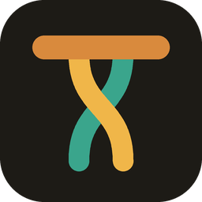

# Talos



**One AI agent for your computer that does what OpenCode and Hermes Agent do, in one place, and
tells you how it checked its own work.**

You type a task. Talos reads and writes files, runs commands, searches the web and your own
notes, and answers. It works with any model: a free local one (Ollama, LM Studio) or a paid one
(OpenAI, Anthropic, OpenRouter, Google and others). It needs only Python. Nothing else to install.

The site, with a run you can read before you install anything: <https://juw12.github.io/talos/>

The name: Talos was the bronze guard of Crete in Greek myth, a machine built to work without
rest. Bronze is an alloy of two metals, as this is one tool made from two. (Not related to Talos
Linux or Cisco Talos.)

## Open it

| You want | Do this |
|---|---|
| Try it now, no model needed | `python -m talos demo` |
| The app window | `python -m talos install-shortcut`, then click **Talos**: on the Desktop or in the Start menu (Windows), in Launchpad or Spotlight (Mac, it is `Talos.app` in your own Applications folder), in the menu (Linux). Or just `python -m talos app` |
| The terminal | `python -m talos` |
| One task, then exit | `python -m talos run "make a script that renames my photos by date" --yes` |

Get it: download this folder (or `git clone https://github.com/juw12/talos`), open a terminal in
it, and run the commands above. Python 3.9 or newer. Or install it as a command:
`pip install git+https://github.com/juw12/talos`, then use `talos` instead of `python -m talos`.

First time: `python -m talos doctor` shows which models and tools it found on your PC.
With [Ollama](https://ollama.com) running, Talos finds its models by itself. For a paid model:
`python -m talos auth set openai YOUR_KEY`, then `python -m talos -m openai/gpt-4o-mini`.

## What it does

**Everything OpenCode does** (37 features built in, 3 through a bridge, 2 missing): terminal chat,
one-shot runs, the same tools (read, write, edit, patch, bash, grep, glob, web), plan and build
agents, your own agents and commands, permissions, undo and redo, sessions, sharing, MCP servers,
language servers, a server with an API, the editor protocol (ACP), GitHub and GitLab jobs.

**Everything Hermes Agent does** (30 built in, 5 through a bridge, 2 untested, 2 missing): memory
that lasts between chats, skills it writes for itself after long tasks, scheduled jobs, search in
past chats, helper agents, a gateway for Telegram, Discord, Slack and other chat apps, running
commands in Docker or over SSH, voice out, image generation.

**What neither has** (20):

- **Proof.** Every run that changed files ends with one honest line: *checked* (it ran something
  after the change and it passed), *re-read only*, *unverified*, or *check failed*.
- **Any model can use tools.** Models with no tool calling get the tools as plain text. Talos
  switches by itself.
- **Small local models work.** Talos reads the model's window size and sends a short prompt that
  fits. If a small model only shows code instead of doing the work, Talos asks it once to act.
  A tool call it cannot read is sent back with the reason instead of ending the run.
- **It knows what you already have.** It searches your Obsidian or Cairn notes where they are, and
  lists your GitHub and local projects (the **Knowledge** page; the `notes` and `projects` tools).
- **One setup for all.** It reads the config, skills, agents and commands that OpenCode, Hermes,
  Claude Code, Codex and Vector already have on your PC. Nothing is copied.
- **A guard.** Skills, memory, rule files and MCP tool descriptions are scanned for hidden
  instructions before the model sees them. A flagged skill is held back until you trust it.
- **Budgets.** A run stops at the number of steps, tokens or money you set.
- **Engines.** Hand a job to OpenCode, Hermes, Claude Code, Codex or Gemini from Talos.
- **Tune.** `python -m talos tune` measures your models on fixed tasks and says which to use.
- **No dependencies.** Python standard library only.

The full table, one row per feature with the test that covers it: [PARITY.md](PARITY.md).

## Your notes, projects and skills

Talos finds an Obsidian vault or Cairn folder by itself. To name folders yourself, put this in
`~/.talos/talos.json`:

```json
{
  "model": "ollama/gemma3:12b",
  "notes": ["D:/Notes"],
  "projects": {"folders": ["D:/Projects"], "owners": ["your-github-name"]},
  "skill_paths": ["D:/Shared skills"],
  "skill_hide": ["work-*"]
}
```

Projects come from the `gh` program (sign in once with `gh auth login`). The list is kept for six
hours in `~/.talos/projects.json`. Notes are read where they are and are sent only to the model
you chose, and only the parts the agent looks up.

## What was checked

- 80 tests passed on the PC where Talos was written (Windows, Python 3.13), in about 4 minutes.
- On a Mac (macOS, Intel) all 93 tests pass with Python 3.14 and with Python 3.9, in about a
  minute. Two are for Windows only and are skipped there; one more needs Python 3.10.
- The first run on that Mac found five faults, all fixed and each with a test: every HTTPS call
  failed on a fresh python.org Python (it ships no certificates; Talos now loads the system's
  list and still checks every certificate); model calls named no program, so the Cloudflare in
  front of a provider answered 403; such an error was shown as a page of HTML; OpenCode and
  Claude Code were installed but not found, because they are not on the PATH an app gets; and
  a job handed to OpenCode was done in the folder Talos was started in, not the project folder.
- A real job through the engines bridge on that Mac: `talos engine opencode` had OpenCode write
  and run a FizzBuzz file in the project folder, and gave its answer back, in 16 seconds.
- The app's page opens on the Mac (looked at in Chrome), and `install-shortcut` makes a
  `Talos.app` that macOS accepts, with the logo; its launcher was started and Talos answered.
  The window itself was not clicked through there. On a Mac the app gets its own window with
  Chrome, Edge, Chromium or Brave; with Safari only, it opens as a tab.
- That commit was read by a second model (OpenCode, `deepseek-v4.1-flash-free`) that did not
  write it. It found no weakening of the certificate check and asked for four fixes, which are
  in: a redirect from http to https, an unbounded error page, two forms of colour code.
- A real run on a free local model (Ollama `gemma3:1b`, 4096-token window, no tool calling):
  asked for a file `hello.py` that prints 12*12. The model first only showed the code; Talos
  asked it to act; the file was created with the right content. The model did not run the file,
  and Talos reported the result as *unverified*, which is correct.
- On a PC kept busy by other programs, the app's own pages answered in 0.2 s while the model
  was working (13 to 19 s before the fix), and a second double-click on the shortcut reused
  the running app instead of starting another copy.
- The app window opens from the Desktop shortcut on Windows 10 with its own taskbar button and
  the Talos logo (checked by reading the window's icon back and looking at the taskbar).
- CI runs the tests, the demo and the install on Windows, Linux and macOS. On 22 Nov 2026 all
  93 tests passed there on Windows (Python 3.13 and 3.9), macOS (3.13 and 3.9) and Linux (3.13).
  The sixth job, Linux with Python 3.9, did not start: GitHub's Linux image no longer offers
  that Python, so Python 3.9 on Linux is unchecked.

## What is not checked, and limits

- The chat gateways (Telegram, Discord, Slack and others) were tested only against local fake
  servers, never against the real services. Email and IRC are untested.
- Docker and SSH backends are tested with stand-in programs, not real containers or hosts.
- The engines bridge has run a real job with OpenCode (on a Mac). Hermes, Claude Code, Codex and
  Gemini were only tested with a stand-in program.
- Free models of OpenCode Zen answer only inside OpenCode. With such a model picked, Talos says
  so in one line and names the agents installed on the computer that can take the job.
- A very small model (1 GB) follows instructions poorly. In two real runs it created the file
  once and wrote a broken tool call once. Use a 7 GB+ local model or a paid model for real work.
- Missing: OpenCode's terminal themes and its IDE extension; Hermes' voice input and its
  reinforcement-learning tools. Listed in [PARITY.md](PARITY.md).
- This is version 0.1.0, made in one long session. Expect rough edges.

## Folders

| Folder | What is in it |
|---|---|
| `talos/` | The program. `cli.py` is the entry, `agent.py` the loop, `tools.py` the tools |
| `talos/web/` | The app window (one HTML file, no internet needed) |
| `tests/` | The tests. Run: `python -m unittest discover -s tests -t .` |
| `packaging/` | Builds the one-file Windows program for releases |
| `docs/` | The site. `tests/test_site.py` holds it to what the program does |

MIT licence. Made by Juwen Lie.
